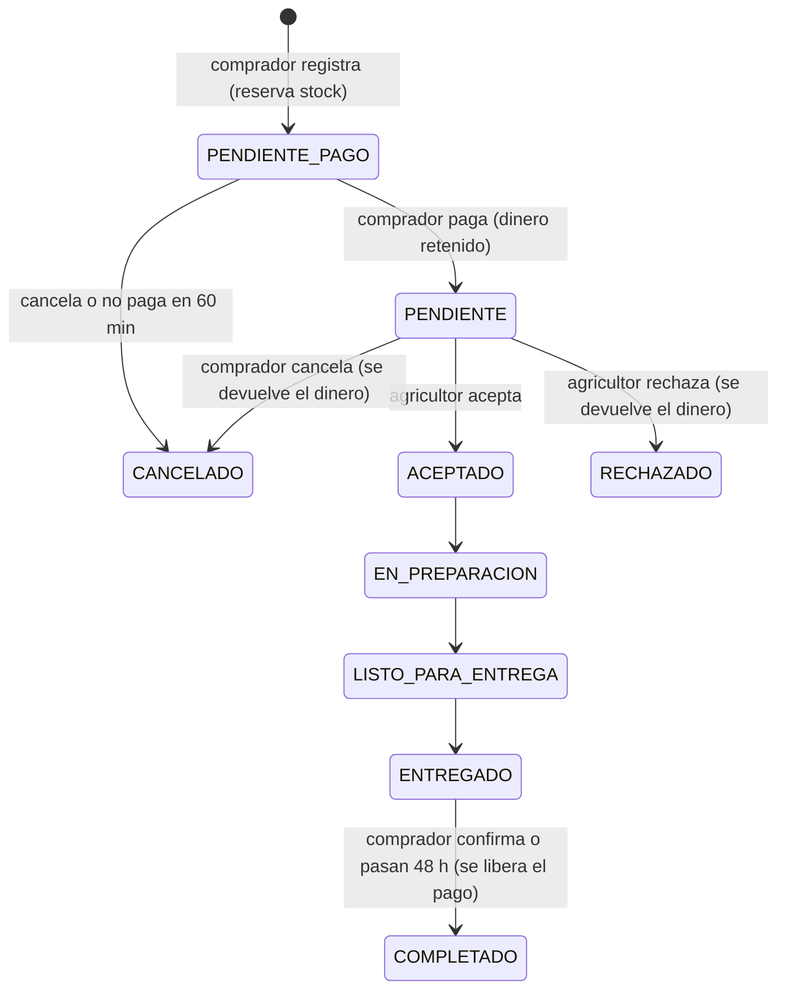

# AgroDirecto — Backend

API REST de AgroDirecto, plataforma que conecta a pequeños agricultores del Perú con restaurantes, bodegas y comercios **a precio justo y sin intermediarios**.

El frontend está en el repositorio [`agrodirecto-project`](https://github.com/andrebm99/agrodirecto-project).
El plan de trabajo por tareas está en [ROADMAP.md](ROADMAP.md).

## Tecnologías

- Java 21 y Spring Boot 4.1 (Web MVC, Data JPA, Validation, Security, WebSocket).
- JWT firmado con HS256 (Spring Security OAuth2 Resource Server).
- MySQL 8 y Flyway para versionar el esquema.
- H2 en modo MySQL solo para las pruebas automáticas.
- Docker Compose para la base de datos local.

## Arquitectura: monolito modular

El código se organiza **por módulo de negocio** y cada módulo tiene sus propias capas:

```text
pe.agrodirecto
├── config/          Configuración transversal (CORS, reloj, propiedades de negocio)
├── compartido/      Errores comunes y utilidades de dinero
├── usuarios/        Cuentas, roles y autenticación
├── productores/     Agricultores, agentes, asociaciones y zonas de cobertura
├── catalogo/        Productos, formatos de venta, precios de referencia y favoritos
├── pedidos/         Cotización, pedidos, estados e historial
├── pagos/           Pago retenido y liberación al agricultor
├── notificaciones/  WhatsApp/SMS al agricultor y avisos web
├── tiemporeal/      WebSocket (STOMP): pedidos y stock en vivo
├── confianza/       Reseñas, reputación y disputas
└── administracion/  Métricas y control de la plataforma

Cada módulo:
  dominio/       Entidades JPA y enums con sus reglas internas
  repositorio/   Acceso a datos (Spring Data JPA)
  servicio/      Casos de uso y reglas de negocio (transaccionales)
  web/           Controladores REST y DTOs de entrada/salida
```

Las dependencias van en un solo sentido, `web → servicio → repositorio → dominio`, y entre módulos no hay ciclos. Por ejemplo, `pedidos` usa `catalogo` y `productores`, pero ninguno de ellos conoce a `pedidos`.

## Ejecución local

Requisitos: JDK 21 y Docker.

```bash
docker compose up -d        # MySQL 8.4 en el puerto 3307
./mvnw spring-boot:run      # API en http://localhost:8080
```

Al arrancar, Flyway crea las tablas (`db/migration`) y carga los datos de demostración (`db/demo`).

| Variable | Valor por defecto |
|---|---|
| `DB_URL` | `jdbc:mysql://localhost:3307/agrodirecto?...` |
| `DB_USER` / `DB_PASSWORD` | `agrodirecto` / `agrodirecto` |
| `PORT` | `8080` |
| `SMS_WEBHOOK_SECRET` | Secreto del webhook de SMS (cambiar en producción) |
| `JWT_SECRET` | Clave de desarrollo (cambiar en producción) |

## Autenticación

| Método | Ruta | Acceso | Descripción |
|---|---|---|---|
| POST | `/api/auth/registro` | Público | Crea una cuenta de comprador, productor o agente |
| POST | `/api/auth/login` | Público | Devuelve el JWT y los datos del usuario |
| GET | `/api/auth/yo` | Con token | Datos de la cuenta de la sesión |

```bash
curl -X POST localhost:8080/api/auth/login -H 'Content-Type: application/json' \
  -d '{"email":"compras@saborandino.pe","password":"demo1234"}'
# Usar el token recibido en las demás peticiones:
curl localhost:8080/api/auth/yo -H 'Authorization: Bearer <token>'
```

- El JWT dura 12 horas y lleva el id del usuario (`sub`) y su `rol`. Spring Security convierte el rol en `ROLE_<rol>` para autorizar las rutas: por ejemplo, `/api/admin/**` solo admite administradores.
- Tras 5 intentos fallidos, la cuenta se bloquea 15 minutos (protección contra fuerza bruta).
- Una cuenta suspendida pierde el acceso de inmediato, aunque su token siga vigente (RN-23).
- No se permiten dos cuentas con el mismo correo, celular o DNI (RN-23), y nadie puede registrarse como administrador (RN-07).
- En producción hay que definir la variable `JWT_SECRET`, de al menos 32 caracteres.

## Productores

| Método | Ruta | Acceso | Descripción |
|---|---|---|---|
| GET | `/api/productores?region=&atiende=` | Público | Directorio de agricultores. `atiende` filtra por la región a la que entregan |
| GET | `/api/productores/{id}` | Público | Perfil público: historia, zona aproximada y zonas de cobertura |
| GET | `/api/regiones`, `/api/asociaciones` | Público | Catálogos para los formularios |
| GET | `/api/gestion/productores` | Productor, agente, admin | Perfiles que el usuario administra |
| POST | `/api/gestion/productores/mi-perfil` | Productor | El agricultor con smartphone crea su perfil |
| POST | `/api/gestion/productores/asistidos` | Agente verificado | Registro de un agricultor sin computadora (RN-B1) |
| PUT | `/api/gestion/productores/{id}` | Quien lo gestiona | Actualiza el perfil |
| POST | `/api/gestion/productores/{id}/verificar` | Su agente o admin | Verificación presencial del DNI (RN-B5) |
| PUT | `/api/gestion/productores/{id}/zonas` | Quien lo gestiona | Regiones que abastece, con días de tránsito, pedido mínimo y flete (RN-09) |

- El perfil público no muestra DNI, celular ni datos de cobro (RN-24), y la ubicación se redondea a unos 1 km (RN-06).
- El medio de cobro se valida según su tipo: Yape o Plin (celular), Cuenta DNI del Banco de la Nación (DNI) o cuenta bancaria (CCI) (RN-C2).
- Si cambia el DNI de un perfil, su verificación se anula.
- Un agricultor sin RUC puede facturar a través de su cooperativa (`emiteFactura`, RN-C3).

## Catálogo

| Método | Ruta | Acceso | Descripción |
|---|---|---|---|
| GET | `/api/productos?q=&categoria=&region=&atiende=&organico=&productorId=&orden=` | Público | Búsqueda que ignora tildes. `orden`: `precio_asc`, `precio_desc` o `cosecha` |
| GET | `/api/productos/{id}` | Público | Ficha con presentaciones, precio por kg, precio de referencia del mercado y productor |
| GET | `/api/categorias`, `/api/precios-referencia` | Público | Catálogos |
| GET | `/api/gestion/productos?productorId=` | Quien gestiona | Productos propios, incluidos borradores y retirados, con alertas de precio |
| POST | `/api/gestion/productos` | Quien gestiona | Crea un producto (`publicar: false` lo guarda como borrador) |
| PUT | `/api/gestion/productos/{id}` | Quien gestiona | Edita el producto y sus presentaciones |
| PATCH | `/api/gestion/productos/{id}/estado` | Quien gestiona | `ACTIVO`, `BORRADOR` o `RETIRADO` |
| GET / PUT / DELETE | `/api/favoritos[/{productoId}]` | Con sesión | Productos guardados |

- **Presentaciones (RN-02):** cada producto tiene de 1 a 6 presentaciones (pequeña, intermedia o mayorista), cada una con su precio y stock. Las que se dejan de enviar se desactivan, no se borran, porque los pedidos antiguos las siguen usando.
- **Precio fijo (RN-A1):** el comprador no puede regatear. El único descuento es por volumen y lo define el agricultor (máximo 30%).
- **Precio justo (RN-A2):** la ficha muestra el precio por kg junto al precio mayorista y minorista de referencia.
- **Alerta de precio bajo (RN-A3):** si una presentación queda más de 10% por debajo del precio mayorista, el agricultor recibe una alerta. No impide publicar, pero así decide informado.
- **Solo agricultores verificados publican (RN-B5):** sin la verificación presencial se pueden guardar borradores, pero no publicar.
- **Stock con bloqueo optimista:** si dos compradores reservan el mismo stock a la vez, solo uno lo consigue.

## Pedidos

| Método | Ruta | Acceso | Descripción |
|---|---|---|---|
| POST | `/api/pedidos/cotizacion` | Comprador | Vista previa con el desglose y todas las validaciones; no reserva stock |
| POST | `/api/pedidos` | Comprador | Registra el pedido (`PENDIENTE_PAGO`) y reserva el stock |
| POST | `/api/pedidos/{id}/pago` | Comprador | Pago simulado (`YAPE`, `PLIN`, `TARJETA`, `TRANSFERENCIA`): el dinero queda retenido |
| GET | `/api/pedidos?estado=` | Comprador | Mis pedidos |
| GET | `/api/pedidos/{id}` | Comprador o quien gestiona al productor | Detalle con historial y acciones disponibles |
| POST | `/api/pedidos/{id}/cancelar` | Comprador | Solo antes de que el agricultor acepte; si ya pagó, se le devuelve |
| POST | `/api/pedidos/{id}/confirmar-recepcion` | Comprador | `ENTREGADO` → `COMPLETADO` y se libera el pago al agricultor |
| GET | `/api/gestion/pedidos?productorId=&estado=` | Productor, agente, admin | Pedidos recibidos |
| POST | `/api/gestion/pedidos/{id}/aceptar` · `/rechazar` | Quien gestiona | Responder al pedido |
| POST | `/api/gestion/pedidos/{id}/estado` | Quien gestiona | `EN_PREPARACION`, `LISTO_PARA_ENTREGA` o `ENTREGADO` |



### Pago retenido (RN-C1, RN-C2)

El comprador **paga primero** y AgroDirecto **retiene el dinero** hasta la entrega:

| Estado del pago | Cuándo | Efecto |
|---|---|---|
| `PENDIENTE` | Pedido registrado | El agricultor **todavía no ve** el pedido: no prepara nada que nadie pagará |
| `RETENIDO` | El comprador pagó | El pedido llega al agricultor con la garantía de que el dinero existe |
| `LIBERADO` | El comprador confirma la recepción, o pasan 48 h sin reclamo | El agricultor recibe su monto en el Yape, Plin, Cuenta DNI o cuenta que registró |
| `DEVUELTO` | El agricultor rechaza o el comprador cancela antes de la aceptación | El comprador recupera su dinero |
| `ANULADO` | Se cancela antes de pagar | No hubo cobro |

Cada 10 minutos, un proceso automático:
- libera los pagos de pedidos entregados hace más de 48 horas sin reclamo, para que nadie retenga indefinidamente el dinero de quien ya entregó;
- cancela los pedidos que no se pagaron en 60 minutos, para que nadie bloquee stock sin intención de comprar.

En el prototipo el cobro es **simulado**. En producción, la confirmación llegaría de una pasarela (Culqi, Mercado Pago o Niubiz) mediante un webhook firmado.

**Cómo se calcula** (siempre en el servidor; el comprador nunca envía precios, RN-A1):

| Concepto | Fórmula | Ejemplo: 2 sacos + 1 arroba de papa a Lima |
|---|---|---|
| Neto del agricultor | Σ precio × cantidad − descuento por volumen | S/ 268.00 |
| Flete | Según la zona de cobertura | S/ 25.00 |
| Servicio AgroDirecto (5%) | Neto × 5%, **lo paga el comprador** (RN-A4) | S/ 13.40 |
| **Total que paga el comprador** | Neto + flete + servicio | **S/ 306.40** |
| **Recibe el agricultor** | Neto + flete, íntegro | **S/ 293.00** |

**Validaciones al registrar el pedido:**

| Regla | Qué valida |
|---|---|
| RN-01 | Todos los productos son del mismo productor |
| RN-03 | El producto está publicado y hay stock suficiente |
| RN-09 | El productor entrega en la región de destino (no aplica al recojo en chacra) |
| RN-10 | La vida útil del producto supera los días de viaje: no se vende lo que llegaría malogrado |
| RN-11 | Se alcanza el pedido mínimo de la zona |
| RN-18 | Una cuenta sin verificar y sin 3 compras completadas tiene topes: S/ 1500 por pedido y 2 pedidos en curso |
| RN-24 | El celular y la dirección exacta se revelan solo cuando el agricultor acepta |
| RN-05 | Solo se permiten las transiciones del diagrama; cada cambio queda en el historial con quién, cuándo y por qué canal |

## Notificaciones: el agricultor no necesita smartphone (RN-B2)

Cuando un pedido se paga, el agricultor recibe un **SMS** que llega a cualquier celular:

```text
AgroDirecto: nuevo pedido AG-2503 de Restaurante Sabor Andino: 3 x Caja de 20 kg de Tomate italiano.
Recibiras S/ 181.00 (pago asegurado). Entrega en Lima hasta el 12/11.
Responde 1 AG-2503 para ACEPTAR o 2 AG-2503 para RECHAZAR.
```

Y responde desde su celular:

| Responde | Efecto |
|---|---|
| `1`, `SI`, `ACEPTO` (con o sin código) | Acepta el pedido. Si tiene varios pendientes, se le pide el código |
| `2`, `NO`, `RECHAZO` (con o sin código) | Rechaza: el comprador recupera su dinero y el stock vuelve a la venta |
| Cualquier otra cosa | Recibe un mensaje de ayuda |

Además:
- Se genera un **enlace de WhatsApp** (`https://wa.me/51...`) listo para que el agente lo reenvíe gratis desde su teléfono.
- El agricultor con cuenta y el agente que lo gestiona reciben el aviso en la **campana web**.
- El comprador recibe un aviso en cada cambio de estado de su pedido.
- Al liberarse el pago, el agricultor recibe un SMS de confirmación con el monto y su medio de cobro.

| Método | Ruta | Acceso | Descripción |
|---|---|---|---|
| GET | `/api/notificaciones` | Con sesión | Campana: avisos y cantidad sin leer |
| POST | `/api/notificaciones/{id}/leida` · `/api/notificaciones/leidas` | Con sesión | Marcar como leídas |
| GET | `/api/gestion/mensajes?productorId=` | Quien gestiona | SMS y WhatsApp enviados a un agricultor |
| POST | `/api/sms/entrante` | Webhook (cabecera `X-Webhook-Secreto`) | Respuesta del agricultor por SMS |

**Diseño:** el módulo `pedidos` publica un evento (`PedidoCambioEstado`) en cada cambio de estado y `notificaciones` lo escucha, así `pedidos` no depende de quién avisa ni de cómo. El envío de SMS está detrás de la interfaz `EnvioSms`: hoy es una simulación que escribe en el log, y para producción basta con otra implementación que use un proveedor real.

Para probar la respuesta por SMS sin un proveedor:

```bash
curl -X POST localhost:8080/api/sms/entrante -H 'X-Webhook-Secreto: cambiar-en-produccion' \
  -H 'Content-Type: application/json' -d '{"telefono":"900000011","mensaje":"1"}'
```

## Tiempo real con WebSocket (STOMP)

El frontend abre **una conexión** a `ws(s)://<servidor>/ws` y se suscribe a los canales que necesita. Así ve los cambios al instante, sin recargar ni consultar cada pocos segundos.

| Canal | Quién puede suscribirse | Qué recibe |
|---|---|---|
| `/user/queue/pedidos` | Cualquier usuario con sesión | Cambios de estado de **sus** pedidos (comprador) |
| `/topic/productores/{id}/pedidos` | Solo quien gestiona a ese productor | Pedidos nuevos y sus cambios (el agricultor no ve los pedidos sin pagar) |
| `/topic/productos/{id}/stock` | Cualquiera, incluso sin sesión | Stock actualizado de cada presentación del producto |

**Seguridad:**
- El JWT se envía en el `CONNECT` de STOMP y se valida con la misma clave que la API REST. Una cuenta suspendida no puede conectarse.
- Cada suscripción revisa los mismos permisos que la API: un comprador o un agente que no gestiona a AndesVerde no puede escuchar sus pedidos.
- Los clientes solo escuchan; el servidor rechaza los mensajes `SEND`.
- Solo se aceptan conexiones desde los orígenes permitidos (CORS).
- Los mensajes se publican **después del commit**, así nunca se anuncia en vivo un cambio que luego se revirtió.

Ejemplo en el frontend con [`@stomp/stompjs`](https://www.npmjs.com/package/@stomp/stompjs):

```ts
import { Client } from "@stomp/stompjs";

const cliente = new Client({
  brokerURL: "ws://localhost:8080/ws",
  connectHeaders: { Authorization: `Bearer ${token}` },
  onConnect: () => {
    cliente.subscribe("/user/queue/pedidos", (m) => {
      const evento = JSON.parse(m.body); // { codigo, anterior, estado, productor, total, ... }
      mostrarAviso(`Tu pedido ${evento.codigo} ahora está ${evento.estado}`);
    });
    cliente.subscribe("/topic/productos/1/stock", (m) => actualizarStock(JSON.parse(m.body)));
  },
});
cliente.activate();
```

**Diseño:** el módulo escucha el mismo evento `PedidoCambioEstado` que las notificaciones, sin tocar `pedidos`. Usa el broker simple en memoria de Spring, suficiente para una instancia del backend. Para varias instancias se cambiaría por un broker externo (RabbitMQ) sin modificar los canales.

### Cuentas de demostración

Contraseña de todas: `demo1234`.

| Correo | Rol |
|---|---|
| `admin@agrodirecto.pe` | Administrador |
| `compras@saborandino.pe` | Comprador verificado (empresa con RUC) |
| `donlucho@correo.pe` | Comprador nuevo (sujeto a límites de cuenta nueva) |
| `andesverde@agrodirecto.pe` | Productor con cuenta propia |
| `promotora@agrodirecto.pe` | Agente de campo que gestiona a cinco agricultores sin computadora |

## Pruebas

```bash
./mvnw test
```

## Equipo

Desarrollo Full Stack — UTP, sección 45554, 2026.
